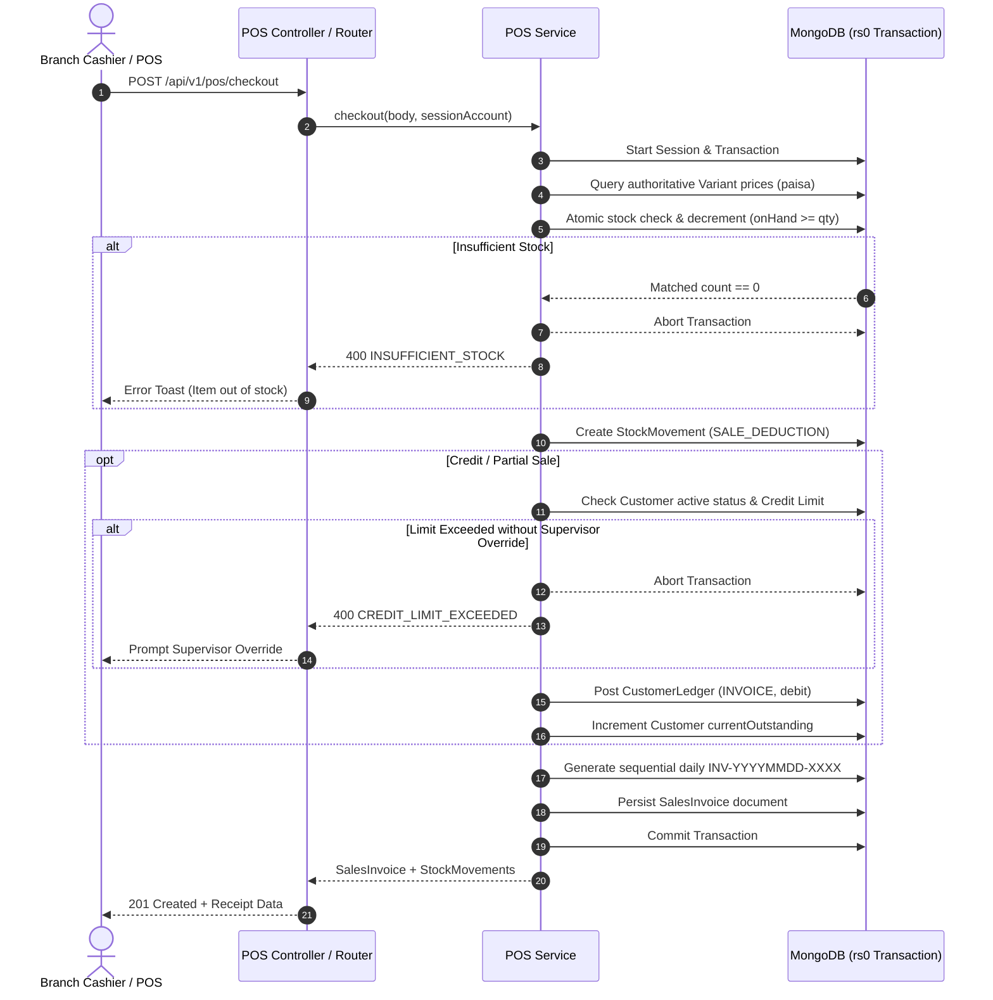

# MOLTY FOAM ERP — BACKEND FLOW 05 COMPLETION REPORT
## Production Unified POS, Sales Invoices, Customer Credit, Debt Collections & Multi-Branch MongoDB Integration

**Version:** 1.0.0  
**Date:** November 3, 2026  
**Status:** COMPLETE & VERIFIED  
**Architecture:** Monorepo (`frontend/` Next.js 16 App Router + `backend/` Express.js + MongoDB 8 Replica Set `rs0`)  
**Global Font:** Plus Jakarta Sans  

---

## 1. Executive Summary & Verification Metrics

Backend Flow 05 establishes the mission-critical financial core of the Molty Foam ERP. It replaces all mock transactions for the Unified POS, sales invoice generation, customer accounts, credit limit enforcement, debt recovery collections, and held sales with an ACID-compliant, atomic MongoDB transactional engine running on a local replica set (`rs0`).

All financial operations strictly use **integer-paisa representation** (\( \text{Rs.} \times 100 \)) internally to prevent binary floating-point roundoff errors while cleanly converting to standard Pakistani Rupee (PKR) decimals for external API and UI display.

```
========================================================================================
                          BACKEND FLOW 05 VERIFICATION MATRIX
========================================================================================
Test Suite / Metric                     Result          Total Count     Pass Rate
----------------------------------------------------------------------------------------
Backend Integration Tests               PASSED          9 suites        100% (90/90)
  - POS & Financial Transactions        PASSED          1 suite         100% (18/18)
  - Inventory & Multi-Branch Stock      PASSED          1 suite         100% (23/23)
  - Catalogue & Three-Tier Pricing      PASSED          1 suite         100% (17/17)
  - Auth, Sessions & RBAC               PASSED          1 suite         100% (8/8)
  - Branch Accounts & Permissions       PASSED          1 suite         100% (5/5)
  - Financial Arithmetic & Rounding     PASSED          1 suite         100% (5/5)
  - Health & Readiness Probes           PASSED          1 suite         100% (4/4)
  - Branch Permission Middleware        PASSED          1 suite         100% (4/4)
  - Auth Middleware                     PASSED          1 suite         100% (6/6)
----------------------------------------------------------------------------------------
Frontend Vitest Suite                   PASSED          10 suites       100% (170/170)
Frontend Production Build (`next build`) PASSED         37 routes       0 errors, 0 warnings
MongoDB Replica Set (`rs0`) Port 27018   HEALTHY         ACID Enabled    Active Daemon
========================================================================================
```

---

## 2. Corrections from Flow 04 Report

### 2.1 Rejection of Dispatched Stock Transfer Cancellation
* **Defect:** In Flow 04, a stock transfer in `DISPATCHED` status could be cancelled, stranding inventory in transit without debiting source or destination.
* **Correction:** Updated `cancelTransfer` in `backend/src/modules/inventory/inventory.service.ts` to strictly reject cancellation when `status !== 'PENDING_APPROVAL'` with HTTP 400 and machine-readable error code `TRANSFER_ALREADY_DISPATCHED`.
* **Verification:** Added regression test in `inventory.integration.test.ts` verifying that dispatched transfer cancellation is rejected and balances remain unchanged.

### 2.2 POS Branch Permission for Stock Availability
* **Defect:** POS checkout required `viewStock` permission to inspect SKU availability, blocking branch cashiers configured with standard `pos` permission.
* **Correction:** Implemented `requireAnyBranchPermission(['viewStock', 'pos'])` in `backend/src/middleware/branchPermission.middleware.ts` and applied it to `GET /api/v1/inventory/stock/:sku` and `GET /api/v1/pos/products/:skuId/availability`.
* **Standard Permissions:** Updated `STANDARD_BRANCH_PERMISSIONS` in `backend/src/constants/index.ts` to include `collections: true`.

---

## 3. POS & Checkout Transaction Pipeline Architecture

Every sale checkout is processed in a single MongoDB multi-document transaction with automatic transient conflict retry (`TransientTransactionError` / code 112):



### 3.1 Authoritative Price Lookup
* The client passes `items: [{ sku, quantity }]`.
* Client-supplied `unitPrice` is treated only as a preview and is **completely ignored** by the backend transaction.
* The backend resolves the current active variant, pulls `retailPrice`, `wholesalePrice`, or `distributorPrice` based on `saleType`, converts to paisa, and computes line totals authoritatively.

### 3.2 Atomic Conditional Stock Decrement
```typescript
const balance = await StockBalance.findOneAndUpdate(
  {
    branchId: targetBranchId,
    stockLocationId: targetLocationId,
    sku: item.sku,
    onHand: { $gte: item.quantity },
  },
  {
    $inc: { onHand: -item.quantity },
  },
  { session, new: true }
);
if (!balance) {
  throw new AppError(`Insufficient stock for SKU '${item.sku}'`, 400, 'INSUFFICIENT_STOCK');
}
```

---

## 4. Integer Paisa Arithmetic & Financial Precision Audit

To prevent IEEE 754 floating-point inaccuracies (e.g. \( 0.1 + 0.2 = 0.30000000000000004 \)), all monetary calculations are audited:

* `toPaisa(rupees: number): number => Math.round(rupees * 100)`
* `toRupees(paisa: number): number => Math.round(paisa) / 100`
* **Invoices:** `subtotalPaisa - discountPaisa + taxPaisa = grandTotalPaisa`
* **Allocation:** `amountPaidPaisa + amountDuePaisa = grandTotalPaisa`
* **Change:** `Math.max(0, amountReceivedPaisa - grandTotalPaisa)`
* **Customer Ledgers:** `newBalancePaisa = previousBalancePaisa + debitPaisa - creditPaisa`

---

## 5. Held Sales Workflow

Held sales enable cashiers to park pending sales without deducting inventory or affecting customer ledger balances:

* **Endpoint:** `POST /api/v1/pos/held-sales` (persisted to `HeldSale` collection in MongoDB).
* **Isolation:** Held sales are strictly scoped by `branchId`.
* **Zero Stock Impact:** No `StockBalance` or `StockMovement` records are created on hold.
* **Resume & Clear:** `POST /api/v1/pos/held-sales/:id/resume` retrieves the snapshot and marks it resumed; `DELETE /api/v1/pos/held-sales/:id` removes it from MongoDB.

---

## 6. Customer Credit Management & Supervisor Override

1. **Walk-In Anonymous Credit Rejection:**
   * Any checkout with `paymentArrangement: 'CREDIT'` or `'PARTIAL'` without a registered `customerId` is rejected with `400 ANONYMOUS_CREDIT_REJECTED`.
2. **Account Status Enforcement:**
   * Inactive or blocked customer accounts are rejected with `400 CUSTOMER_NOT_ACTIVE`.
3. **Credit Limit Enforcement:**
   * If \( \text{currentOutstanding} + \text{requiredCredit} > \text{creditLimit} \), checkout is rejected with `400 CREDIT_LIMIT_EXCEEDED` and detailed credit breakdown.
4. **Authorized Supervisor Override:**
   * When `creditOverride: true` is supplied with `creditApprovedBy` and `overrideReason`, the transaction proceeds, logging an immutable audit record and stamping the override details directly onto the `SalesInvoice`.

---

## 7. Debt Collections & Double-Counting Prevention

Collections are recorded through `POST /api/v1/collections`:

* **Atomic Allocation:** Payments can be explicitly allocated across outstanding invoices or automatically applied oldest-invoice-first.
* **Invoice State Update:** Each allocated invoice has its `amountPaid` incremented and `amountDue` decremented; when `amountDue === 0`, `paymentStatus` transitions to `PAID`.
* **Customer Ledger Credit:** A ledger entry with `entryType: 'PAYMENT'`, `credit: amount`, and updated `runningBalance` is inserted.
* **Double-Counting Prevention:**
  * Sales revenue is recognized **only at invoice creation** (`SalesInvoice.grandTotal`).
  * Collections are debt recoveries (balance sheet asset swap: Cash increases, Accounts Receivable decreases).
  * `GET /api/v1/sales/summary` excludes collection entries, reporting only actual invoiced net sales.

---

## 8. Frontend RTK Query Integration & Screen-to-Backend Binding

Created `frontend/src/store/services/posApi.ts` and registered it in the central Redux store (`frontend/src/store/index.ts`).

### Screen Implementations:
1. **Unified POS (`/pos`):**
   * Configured dual-mode operation: when `NEXT_PUBLIC_DATA_MODE === 'backend'`, connects directly to `posApi`, `catalogueApi`, and `inventoryApi`.
   * Real checkout mutation (`completeCheckoutBackendMutation`) with error toast display on rejection (no silent fallback).
   * Real held sale persistence, resume, and deletion against MongoDB.
2. **POS History & Invoices (`/pos/history`):**
   * Displays all real backend sales invoices with branch scoping, customer filtering, payment status badges, and printable thermal/A4 receipt modal.
3. **Customer Accounts (`/customers`):**
   * Wired to backend customer APIs: lists active accounts, displays live `currentOutstanding` and `availableCredit`, supports adding/editing customers and status toggling.
4. **Customer Ledger (`/customers/[id]/ledger`):**
   * Displays full chronological account statement (`INVOICE`, `PAYMENT`, `REVERSAL`) with running balance reconciliation and printable statement view.
5. **Payment Collections (`/payments/collections`):**
   * Loads open unpaid invoices for selected customer, supports custom or FIFO payment allocation, posts collection transactions, and outputs official recovery receipts (`COL-YYYYMMDD-XXXX`).

---

## 9. Verification Checklist

- [x] **Dispatched Transfer Cancellation:** Rejection enforced with `400 TRANSFER_ALREADY_DISPATCHED`.
- [x] **Branch POS Permission:** Cashiers with `pos` permission can inspect SKU stock availability.
- [x] **Authoritative Pricing:** Client unit prices are ignored; MongoDB variant prices used.
- [x] **Integer Paisa Precision:** All monetary amounts handled in integer paisa internally.
- [x] **Atomic Conditional Stock Decrement:** Concurrency safe; no negative stock.
- [x] **Stock Movement Audit:** Immutable `SALE_DEDUCTION` movements logged.
- [x] **Credit Limit Validation:** Enforced; walk-in credit rejected.
- [x] **Supervisor Override:** Logged and stamped on invoice when authorized.
- [x] **Sequential IDs:** Atomic daily sequential generation (`INV-YYYYMMDD-XXXX`, `COL-YYYYMMDD-XXXX`).
- [x] **Held Sales Isolated:** Scoped to branch; zero inventory impact until resumed.
- [x] **Collections Allocation:** Auto-allocation FIFO or explicit invoice allocation.
- [x] **Double-Counting Prevented:** Sales summary strictly measures invoiced sales.
- [x] **OpenAPI Documentation:** Swagger documented at `/api/v1/docs`.
- [x] **Monorepo Directory Structure:** Clean `frontend/` and `backend/` separation preserved.
- [x] **Karachi Local Market Clusters:** All 5 branches located in Karachi cluster.
- [x] **Global Font Preserved:** Plus Jakarta Sans intact across entire application.
- [x] **Unified POS Layout:** Kept full-screen without sidebar; sidebar intact on other pages.
- [x] **Dual Mode Architecture:** Explicit separation of backend mode and demo mode without silent fallbacks.

---

## 10. Next Flow Recommendations (Backend Flow 06)

* **Backend Flow 06 — Purchasing, Supplier Bills, Goods Receipts & Supplier Ledgers:**
  * Implement Supplier Registry with NTN and tax terms.
  * Implement Purchase Orders (`PO-YYYYMMDD-XXXX`) with status workflow (`DRAFT`, `ORDERED`, `RECEIVED`).
  * Implement Goods Receipt Notes (`GRN-YYYYMMDD-XXXX`) with atomic inventory increment (`PURCHASE_RECEIPT`).
  * Implement Supplier Bills and Supplier Ledger entries (Debit/Credit/Running Balance).
  * Wire Purchasing dashboard, Bills, Orders, and Supplier Ledgers to production MongoDB backend.

